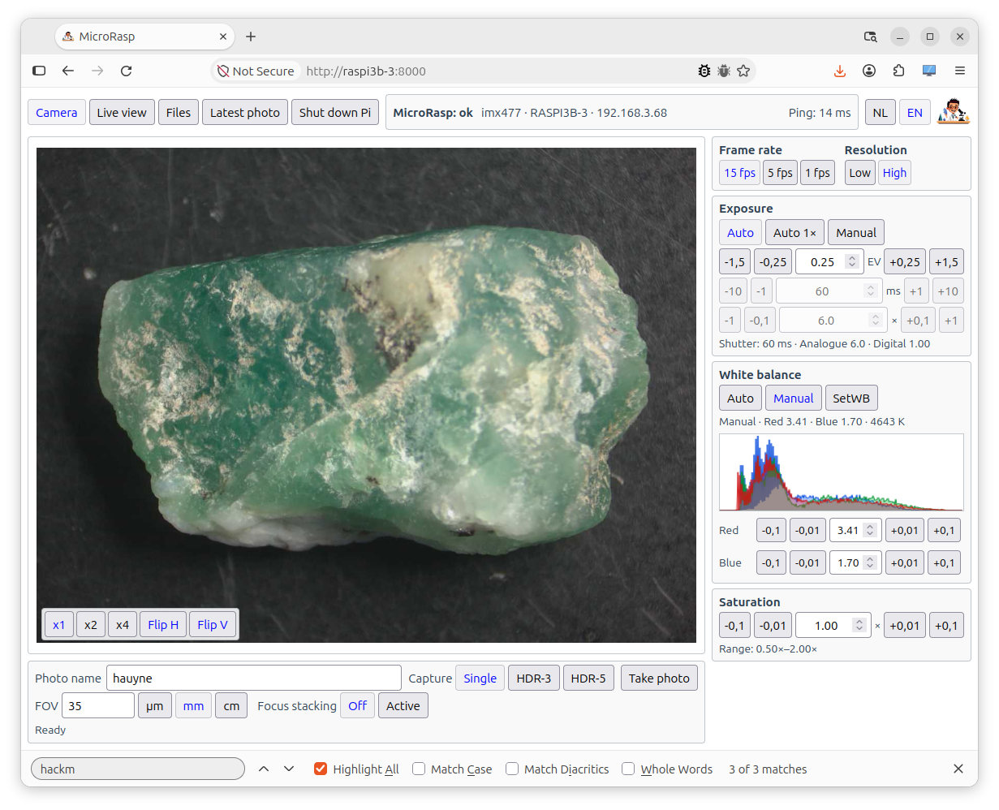

[English](README.md) | [Nederlands](README.nl.md)

# MicroPiHQ

Pakket voor het gebruik van de HQ camera en een raspberry Pi, specifiek voor een microscoop of voor macro-opnames. Dit is een nieuwe versie van Microscope-Picam, maar nu gebaseerd op libcamera en Picamera2. Het doel is het maken en opslaan van foto's, video wordt ondersteund voor preview maar niet om op te slaan.

*De gebruikersinterface*

# Technisch

De Pi en de camera zijn via cmount aan de reductielens van de microscop of een objectief verbonden. De communicatie is via wifi. Alleen een voedingskabel is nodig voor de Pi. De software werkt vanaf Pi3B, waarbij werking op de Pi3B+ en Pi4 daadwerkelijk getest is. Op de Pi draait een kleine webserver, zodat de camera via een browser in het netwerk kan worden bestuurd. Uitgangspunt is dat de camera alleen lokaal wordt gebruikt, er is dus geen toegangsbeveiliging. Iedereen met toegang tot de Pi via het netwerk kan de software gebruiken. 

De bestanden kunnen het meest eenvoudige via een SFTP verbinding van de Pi worden gelezen. Het is natuurlijk ook mogelijk om de desktop op de Pi te activeren. Daarnaast kan de terminal worden gebruikt.

*De cmount verbinding met de reductielens. Er is gebruik gemaakt van het standaard acryl plaatje zodat camera en Pi een geheel vormen*

# Installatie

De installatie gaat ervan uit dat de laatste versie van Trixie is geinstalleerd op de SD kaart. Kan zowel de lite versie zijn als de versie met een desktop, alhoewel dat laatste voor de Pi3B+ al gauw te zwaar wordt. Verder moet de HQ camera zijn aangesloten en getest met rpicam-still.

Download de ZIP (MicroPiHQ.zip) van de laatste release (rechterkolom in github), unzip deze in een directory op de Pi en draai het *install.sh* script. Aan het eind vindt een check van de implementatie plaats. Bij problemen kan script *check-installation.sh* worden gedraaid, dit script test of alle noodzakelijke componenten aanwezig zijn.

De fotobestanden staan in de directory photos onder de installatie. Ik heb dit niet configureerbaar gemaakt om het zo eenduidig mogelijk te houden.

*De camera is benaderbaar op: http://adres-van-de-Pi:8000*

De host die de camera benadert moet de Pi op poort 8000 kunnen bereiken.

Het installatiescript installeert een service, zodat de webserver wordt gestart bij het starten van de Pi. Als dit niet gewenst is kan dit worden uitgezet met het script *disable-autostart.sh*. Met het script *enable-autostart.sh* kan het weer worden geactiveerd. Daarnaast is er een start en stop script om de webserver separaat te starten en te stoppen.

Voordat je de software verwijdert eerst het *uninstall.sh* script draaien. Daarna kan de directory worden verwijderd. De geinstalleerde software pakketten worden niet verwijderd door het uninstall.sh script.

Upgraden kan door de nieuwe versie te downloaden, over de bestaande installatie te unzippen, en dan het install script weer te draaien.

**Let op bij oudere installaties:** de ZIP bevat nu de map `MicroPiHQ/`. Heeft de bestaande installatie een andere mapnaam, kopieer dan de inhoud van `MicroPiHQ/` naar de bestaande installatiemap en voer dáár `./install.sh` uit. De bestaande `photos/` en `.env.local` blijven daarbij behouden.

# functies

Gewone foto's

Standaard bracket foto's, zowel drievoudig -1.5 EV, 0, 1.5 EV als vijfvoudig, -3 EV, -1.5 EV, 0, +1.5 EV, +3 EV. De stapgrootte is aan te passen in de .env.local.

Handmatige stack. Na activatie wordt na elk frame het nummer automatisch verhoogt en blijft de YYMMDD-HHMMSS van het bestand ongewijzigd tussen de verschillende frames.

Ingave Field Of View (handmatig)

Automatische belichting (met of zonder correctie) in twee modes: zowel analoge versterker en sluitertijd zijn variabel, of alleen de sluitertijd en de versterking altijd op minimum (1x). dit laatste reduceert de ruis. Daarnaast een handmatige mode. De preview window kan bij 15 fps geen langere sluitertijden dan 66 ms aan. Voor langere sluitertijden in de preview moet 5 fps worden gekozen. Er is op dit moment een beperking tot een max sluitertijd van 120 ms in het preview window bij automatische belichting. 

Kleurverzadigingsinstelling

Histogram

Witbalans. Kan zowel automatisch als handmatig. de praktijk leert dat handmatig bijna altijd noodzakelijk is bij microscoopgebruik. De knop setWB maakt de groen, rood en blauwintensiteiten gelijk. Leg daarvoor een wit vlak voor de camera zodat de juiste witbalans wordt ingesteld.

Liveview: naast de camera de liveview. Hier wordt het live microscoopbeeld getoond 

Linksboven een bestanden tab. Dit is een heel rudimentaire filebrowser waar beeldbestanden zijn te downloaden. De software gaat ervan uit de bij normaal gebruik via een terminal of SFTP de photos directory wordt benaderd. Gebruik SFTP vereist dat op de Pi SSH is ingeschakeld.

Dan een tab laatste foto. Alle afbeeldingen / brackets van de laatste foto worden getoond om een indruk te geven

Tenslotte de tab "Stop Pi". Dit geeft de Pi een shutdown signaal waardoor de verbinding met de camera wordt verbroken.

Rechtsboven een taalinstelling: NL of EN

*De tab met de laatste genomen foto's* 

# Bestandsnamen

Omdat er veel bestanden worden gemaakt, is de naamgeving rigide.

## Enkelvoudige opnames

Bestandsnaam is YYMMDD-HHMMSS-[ingevulde naam].jpg

## Bracket bestanden (HDR)

Bestandsnaam is YYMMDD-HHMMSS-[ingevulde naam]-AEB-[stops].jpg

*Foto van een dynosaurus bot*

## Stackingframes

Bestandsnaam is YYMMDD-HHMMSS-[framenummer]-[ingevulde naam]-[AEB-[stops]].jpg

# Bewerken bestanden

De nabewerking van de foto's zal meestal stuk voor stuk moeten gebeuren voor het beste resultaat. Er is een script toegevoegd aan de photos directory, "mertens.sh". Deze gebruikt defaults om een eerste fotoset samen te stellen. Gebruik: ./mertens.sh YYMMDD-HHMMSS. Als het AEB brackets betreft wordt door middel van enfuse en magick bewerkt. Dit genereert de bestanden: YYMMDD-HHMMSS-[ingevulde naam].jpg. Daarnaast ook een .tif bestand voor mogelijk verdere verwerking. En een contrast verbeterd bestand YYMMDD-HHMMSS-[ingevulde naam]-contrast.jpg. Deze laatste kan soms behoorlijke kleurveranderingen opleveren, en soms gaat het helemaal goed.

Als het stackframes betreft wordt er een directory gegenereerd YYMMDD-HHMMSS-focusstack waarin voor elk frame een .tif bestand wordt gemaakt (als er gebruik werd gemaakt van brackets), of een .jpg als het enkele foto's betreft. Deze kan dan in een stacking programma worden verder bewerkt.

Voor het verwerken van alle sets in een map is er ook *mertensall.sh*. Voer in de photos-directory `./mertensall.sh` uit, of geef een andere map op met `./mertensall.sh /pad/naar/photos`. Het script zoekt alle unieke YYMMDD-HHMMSS-series met AEB-brackets of focusstackframes en roept voor elke serie *mertens.sh* aan. Gewone losse foto's worden overgeslagen. Bij opnieuw uitvoeren worden de gegenereerde resultaten opnieuw gemaakt; de oorspronkelijke foto's blijven behouden.

# Aandachtspunten

## Resolutie preview

Standaard staat de resolutie van de preview op hoge resolutie (1280 x 960). Als het netwerk vertragingen kent, kan de preview worden worden geschakeld naar lage resolutie (640 x 480).

## Belichting

De Pi kent voor de belichting twee instellingen. De sluitertijd in milliseconden, en de analoge versterkingsfactor. De minste ruis treedt op bij een zo laag mogelijke analoge versterking: 1x. Omdat microscoopbeelden in principe niet bewegen is een langere sluitertijd geen probleem. Praktisch gesproken is het het beste om de belichting eerst volledig automatisch in te stellen. Dan op Auto 1x te zetten. De sluitertijd kan dan tegen de maximum grens aan lopen waardoor het beeld te donker wordt. Kies dan 5 frames per second. De sluitertijd loopt dan door tot maximaal 120 ms. Nog steeds te donker? Schakel over naar handmatig en stel de tijd zelf in. Natuurlijk kan er ook gewoon in volledig automatische mode worden gewerkt, alleen kan dan de ruis toenemen. Let op het instellen van de camera zoals beneden beschreven!

## Field of view

Deze waarde wordt door MicroPiHQ alleen gebruikt om in het exif bestand deze als parameter op te nemen. Het *mertens.sh* script kopieert deze waardes eveneens naar de gegenereerde afbeeldingen.

## Witbalans

De witbalans kan het beste worden ingesteld door een wit vlak met de te gebruiken belichting voor de camera te houden. Dan op SetWB te klikken. De balans gaat dan naar handmatig. Meestal zal dan het beeld nog net niet helemaal wit zijn. Leg daarom met de fijnafregeling voor blauw en rood in het histogram de drie kleuren over elkaar heen.

## Stabilisatie camera na wijzigingen

Na wijzigingen in belichting, witbalans of kleurverzadiging kan het soms even duren (enkele seconden) voor de Pi zich weer goed heeft ingesteld op de nieuwe instellingen. Geef het apparaat gewoon de tijd daarvoor. Dit geldt in het bijzonder bij de instelling Auto 1x of een manual instelling met lage versterking. Laat de Pi even zijn gang gaan!

# Github pull requests, github issues

Issues kunnen worden opgevoerd. Afhandeling daarvan is onregelmatig.

Ik accepteer geen pull requests. In deze AI tijd los ik deze zelf op om ook de controle te houden. Deze software opent tenslotte een webserver ergens op een netwerk en dat betekent dat ik elke pull request moet gaan beoordelen of er geen backdoor inzit. Zal meestal niet zo zijn. Dus is er een probleem? Voer een issue op. 

**Licentie:** [GNU AGPL v3](LICENSE). Externe codebijdragen en pull requests worden niet geaccepteerd.

# Achtergrond

Ik ben een edelsteenkundige (gemmoloog), en een software-ontwikkelaar. Omdat ik een aantal microscopen heb, zocht ik naar een oplossing om deze alle te voorzien van vooral een lichtgewicht camera. Daarbij was ookondersteuning van HDR en focus stacks noodzakelijk. De hardware van Pi + HQ is (was?) goedkoper en flexibeler
en minder zwaar dan een DSLR. En doordat ik vier Pi/HQ instanties heb
heeft iedere microscoop zijn eigen permanente installatie. ik vond geen pakket voor de Pi die dit biedt 
met de door mij gewenste functies. Vijf jaar geleden heb ik iets soortgelijks gebouwd, maar de drivers worden niet meer ondersteund door 
het nieuwe OS. In 2021 programmeerde ik alles zelf, dit pakket uit 2026 is gevibecode in aardige samenwerking met Chatgpt 5.6 Sol.

De basissoftware was gereed in een week. Een distributeerbaar product duurde nog eens 10x zo lang.

## Effect van HDR

*Foto van tektiet gebaseerd op vijf brackets*

*Zelfde foto, maar nu als enkele opname. Er is in het zwart veel minder detail zichtbaar*

## Effect van HDR en stacking

Het effect kan subtiel zijn, maar in de gestackte HDR versie is meer detail en scherpte te zien dan in de enkele foto.
Met name het voorste takje, het detail in het scharnier, en de soldering. Dit is het verschil tussen een OK-ish plaatje en
een afbeelding die alles in een enkele keer goed laat zien. Het is een detail van een broche met daarin vier verbindingen:
goudsoldeer, lood-tinsoldeer, lijm en een klinknagelverbinding.

*De gestackte HDR versie*

*Een enkele foto scherpgesteld op het midden.*
